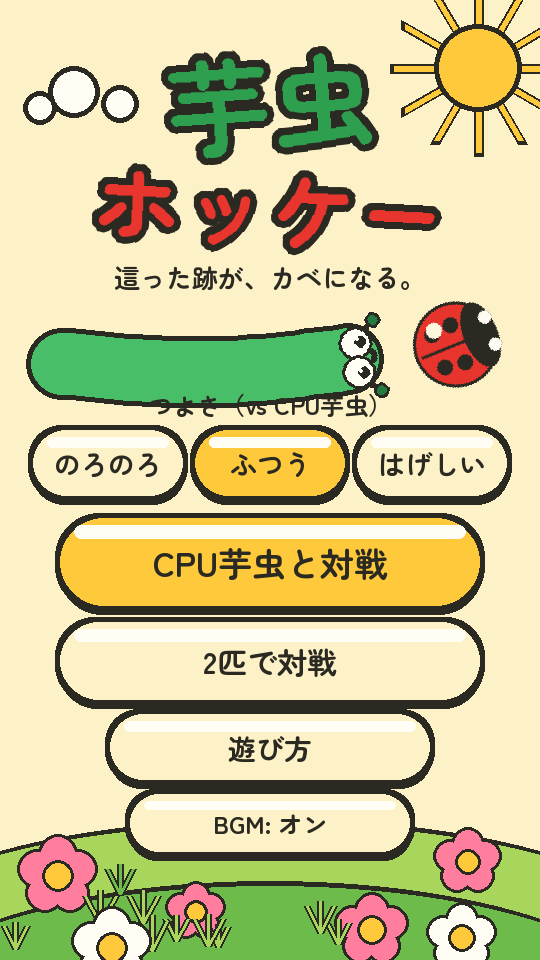
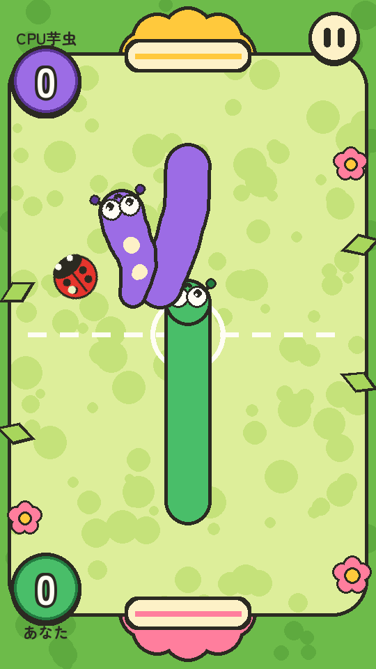
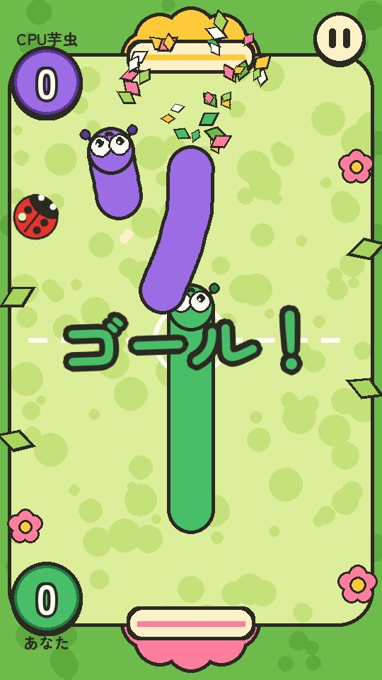
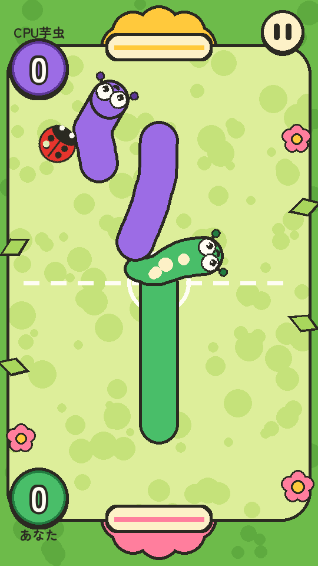
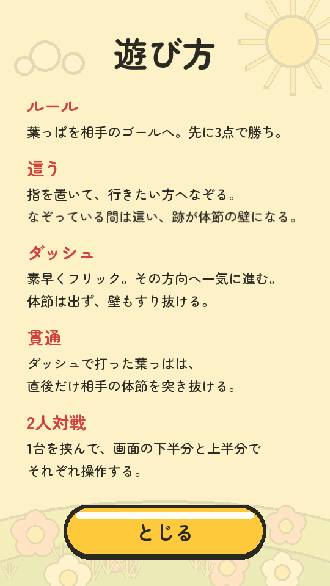
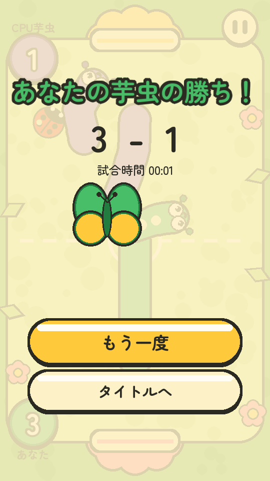

# スマホ版の見た目 — C案「絵本の庭」

`claude/mobile-visual-polish` で作り直したスマホ縦画面の画面写真。
`python dev/render_mobile.py` で `dev/out/mobile/` に出力したものをここへ置いている。

| 画面 | |
|------|---|
| タイトル |  |
| 試合中 |  |
| ゴール演出 |  |
| ダッシュ |  |
| 遊び方 |  |
| 結果（蝶） |  |

## PR 本文の下書き

このリポジトリへの push 権限がこの環境になかったため、Draft PR は作成できていない。
作成する場合は以下をそのまま本文に使える。

---

### スマホ版の見た目を「絵本の庭」に作り直し、体節が出ないバグを直す

**base: `claude/mobile-web` / head: `claude/mobile-visual-polish`（Draft）**

#### 1. 体節が表示されないバグ（最優先）

作業指示にあった推測は**事実だった**。`Fence.until` は `game.game_time` 基準なのに、
`mobile_main.py` のループは描画に `time.perf_counter() - start_time` を渡していた。
2つの時計は「`MAX_FRAME_DT` による dt の頭打ち」「ポーズ中は進まない」でずれ続け、
ずれが体節の寿命（2.6秒）を超えた時点で `caterpillar_art.fence_fade` が全部を寿命切れと判定していた。
スマホのブラウザはタブを離れると1フレームが数十秒に化けるので、実機ではすぐこの状態になる。

- 直し方: 描画も `game.game_time` で行う（ループ本体を `run_frame()` に切り出した）。
- 回帰テスト: `TrailRenderingTest` が `run_frame()` を**壁時計を600秒ずらした状態**で回し、
  這った跡のピクセル数（頭だけの分を差し引く）を数える。元のコードならここで 0 になる。
- ついでに見つけた別の穴: 1フレームの移動量が「体節の間隔〜つなげる上限」の窓をまたぐと
  跡が1つも出なくなる。フレーム落ちしたスマホで起きるので、スマホ側だけ上限を広げた
  （`tuning.trail_max_gap()`、`test_trail_survives_laggy_frames`）。

#### 2. 芋虫の身体

丸を並べるのをやめ、頭から尻尾まで**1本のチューブ**として描く（`mobile_art.draw_tube`）。
点列を半径の 0.26 倍まで細かく打ち直してから、輪郭をすべて先に、中身をあとに塗る。
節のくびれ・つなぎ目の段差・節ごとの色分けは出ない。頭も胴と同じ太さ。曲がり角も丸くつながる。
這った跡と頭は一続きに描き、寿命が近い尻尾側は縮めて消す。

#### 3. 「絵本の庭」

輪郭 `#2B2A22`、丸い形、明るい色で統一。コートは苔の広場 `#DDEE9A`＋まだら `#C5E27A`、
地面 `#6DBB4A`、中央は白の破線。ゴールは花びらのアーチ（上 `#FFC93C` / 下 `#FF7E9D`）。
芋虫は自分 `#49BE69` / 相手 `#9C6CE5`、大きな白目で進行方向を見る。ボールはてんとう虫。
スコアはコート隅の丸バッジ、ポーズは右上の丸ボタン。タイトルは太陽・丘・花・大きな芋虫とてんとう虫。

コートを縦画面へ直接描くようにしたので、横画面の描画を回転ブリットする処理と
**コート両脇の黒い帯がなくなり**、画面を広く使えるようになった。

#### 4. パッと見の分かりやすさ

身体の太さ 60px、ボール直径 59px（画面上）。当たり判定も同じ寸法にしている（`tuning.py`）。
PC 版は倍率 1.0 のままで、見た目もバランスも変えていない。

#### 5. 演出

ゴール（花びらと葉＋大きな「ゴール！」）、勝利（サナギ→蝶）、ダッシュ（波打つ身体＋土ぼこり）、
強打（短い画面の揺れと一瞬の停止）、貫通（葉のかけら）、ボタンの弾み、大きなカウントダウン。

#### 6. 性能

`dev/render_mobile.py` の実測（540x960・ヘッドレス）: タイトル 1.6 / カウントダウン 1.0 /
試合中 1.1 / ゴール演出 2.3 ms/frame。静止物（庭・コート・タイトル背景）と文字は焼いて使い回す。
Web 版の配布サイズは 10.3MB → 6.2MB（スマホ版が使わない PC 版の画像とフォント1本を外した）。

#### 画面写真

`docs/mobile-concepts/` を参照。

🤖 Generated with [Claude Code](https://claude.com/claude-code)
